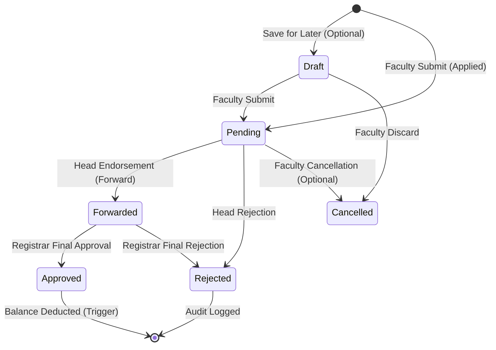

# Firestore Data Integrity, Transactions & State Transitions

## 1. Overview of Data Integrity Mechanisms

In Leavexa, data integrity across distributed clients and backend workers is maintained through four interlocking layers:

```
┌────────────────────────────────────────────────────────┐
│ 1. Client Model Validation (Dart / Flutter)           │
│    • Model factory parsers & form input validators     │
└───────────────────────────┬────────────────────────────┘
                            ▼
┌────────────────────────────────────────────────────────┐
│ 2. Firestore Security Rules (Declarative Constraints) │
│    • Field immutability & schema type checking         │
│    • Atomic cross-document validation                  │
└───────────────────────────┬────────────────────────────┘
                            ▼
┌────────────────────────────────────────────────────────┐
│ 3. Firestore Multi-Document Transactions (ACID Mutex)  │
│    • Registration & Employee ID reservation            │
│    • Initial Admin bootstrap lock                      │
└───────────────────────────┬────────────────────────────┘
                            ▼
┌────────────────────────────────────────────────────────┐
│ 4. Cloud Functions Trigger Idempotency & Atomicity     │
│    • Atomic balance deduction (FieldValue.increment)   │
│    • Immutable audit logging (audit_logs append-only)  │
└────────────────────────────────────────────────────────┘
```

---

## 2. Multi-Document Transactions & Atomic Updates

### A. Faculty Registration & Employee ID Reservation
- **Vulnerability**: Two users registering simultaneously with the same institutional Employee ID (`FAC-1024`) could both succeed if checked with non-transactional reads.
- **Solution in [`UserRepository.createFacultyUser`](file:///Users/Arman/Desktop/leavexa/lib/repositories/user_repository.dart)**:
  ```dart
  await _service.runTransaction((transaction) async {
    final empRef = firestore.collection('employee_ids').doc(normalizedEmpId);
    final empDoc = await transaction.get(empRef);
    if (empDoc.exists) {
      throw const AuthException(
        code: AuthErrorCode.duplicateEmployeeId,
        message: 'This Employee ID is already registered.',
      );
    }

    final userRef = firestore.collection('users').doc(user.uid);
    transaction.set(empRef, {
      'uid': user.uid,
      'createdAt': FieldValue.serverTimestamp(),
    });
    transaction.set(userRef, user.toMap());
  });
  ```
- **Integrity Guarantee**: The transaction locks `employee_ids/{employeeId}`. If two concurrent requests arrive, one will fail with an immediate contention error or detect `empDoc.exists`.
- **Security Rule Enforcement**: Line 100 & 143 in `firestore.rules` verify that both writes exist in the transaction batch (`existsAfter` / `getAfter`).

### B. Initial Admin Provisioning Mutex
- **Vulnerability**: Multiple actors simultaneously invoking `provisionInitialAdmin` could create multiple competing root administrators.
- **Solution in [`functions/src/roles.js`](file:///Users/Arman/Desktop/leavexa/functions/src/roles.js)**:
  - Runs inside `db.runTransaction`.
  - Inspects `system_config/bootstrap`. If `isBootstrapped === true` or any user has `role == 'admin'`, the transaction aborts with `already-exists` ($409$).
  - Once successful, locks `system_config/bootstrap` before provisioning Admin custom claims.

### C. Leave Balance Deduction Idempotency
- **Vulnerability**: Cloud Function triggers (`onLeaveApplicationUpdate`) can experience retries due to network blips or container cold-starts. Unchecked retries would deduct leave balances multiple times.
- **Solution in [`functions/src/leaves.js`](file:///Users/Arman/Desktop/leavexa/functions/src/leaves.js)**:
  - Checks if `balanceDeducted === true` on the application snapshot.
  - If `true`, the trigger immediately terminates with no-op.
  - Deduction runs inside `db.runTransaction`:
    - Checks `balanceSnap.data().used + totalDays <= totalAllotted`.
    - Atomically sets `used: currentUsed + totalDays`.
    - Stamps `appRef` with `balanceDeducted: true` and `balanceDeductedAt: serverTimestamp()`.
    - Writes `audit_logs` record inside the same transaction.

---

## 3. Leave Application Lifecycle State Machine

Leave applications transition through a strict, one-way finite state machine:



### State Transition Validation Table

| Current Status | Permitted New Status | Acting Role | Enforcing Layer | Permitted Field Modifications |
| :--- | :--- | :--- | :--- | :--- |
| `[None]` | `pending` | Faculty | `firestore.rules` (create) | Complete application payload (`applicantUid`, `dates`, `reason`, etc.) |
| `pending` | `forwarded` | Department Head | `firestore.rules` (update) | `status`, `headUid`, `headComment`, `headActionAt` |
| `pending` | `rejected` | Department Head | `firestore.rules` (update) | `status`, `headUid`, `headComment`, `headActionAt` |
| `forwarded` | `approved` | Registrar | `firestore.rules` (update) | `status`, `registrarUid`, `registrarComment`, `registrarActionAt` |
| `forwarded` | `rejected` | Registrar | `firestore.rules` (update) | `status`, `registrarUid`, `registrarComment`, `registrarActionAt` |
| `approved` | `approved` (`balanceDeducted: true`) | Cloud Functions | Admin SDK trigger | `balanceDeducted`, `balanceDeductedAt`, `updatedAt` |
| `pending` / `draft` | `cancelled` | Faculty | `firestore.rules` / Service | `status`, `cancelledAt` |

---

## 4. Referential Integrity Limitations & Mitigations

As a NoSQL document database, Firestore does not provide native relational foreign key cascades or foreign key constraints. The following potential anomalies and their Leavexa mitigations are documented below:

| Potential Relational Anomaly | Risk Level | Mitigation Implemented |
| :--- | :---: | :--- |
| **Orphaned User Deletion** | High | Client SDKs are denied document deletion across all collections (`allow delete: if false;`). Accounts can only be deactivated (`isActive: false`), never hard-deleted. |
| **Department Renaming** | Low | `users.departmentName` is denormalized. If an admin renames a department, existing records retain their name. A background batch script can sync current department names if necessary. |
| **Application Referencing Non-existent User** | Medium | `firestore.rules` requires `request.resource.data.applicantUid == request.auth.uid`, ensuring that the applicant is an authenticated, existing user. |
| **Exceeding Leave Balance** | High | Cloud Functions transaction checks `used + totalDays <= totalAllotted`. If requested days exceed available quota, deduction fails gracefully and logs an audit error without corrupting balances. |
